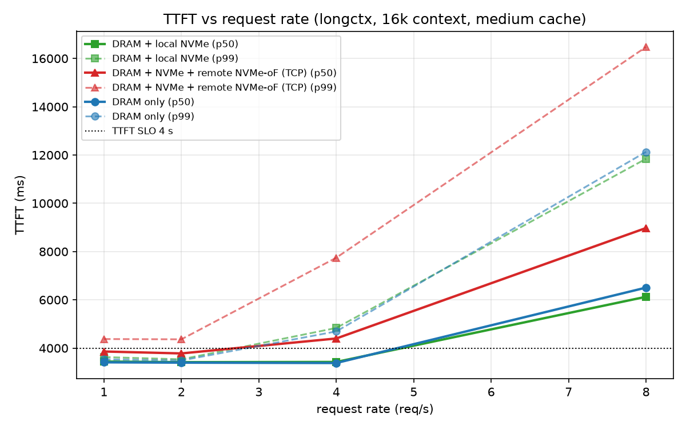
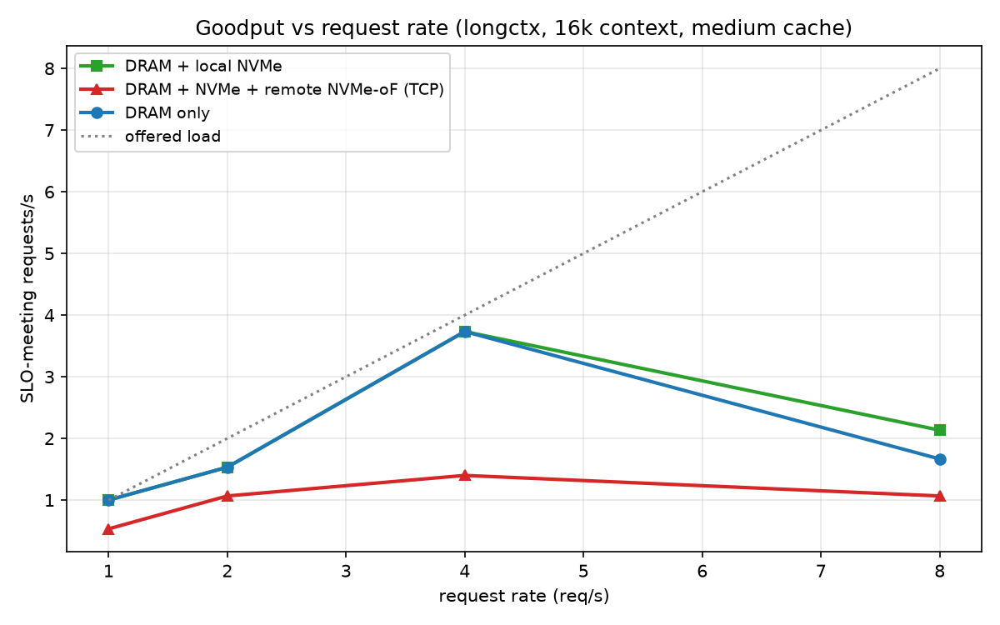
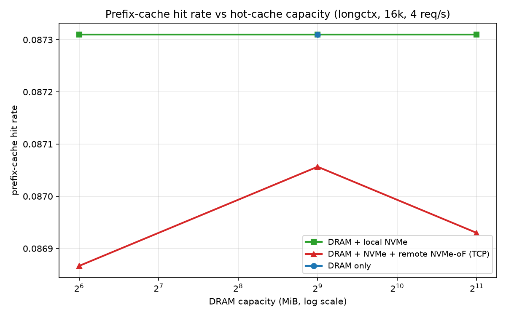
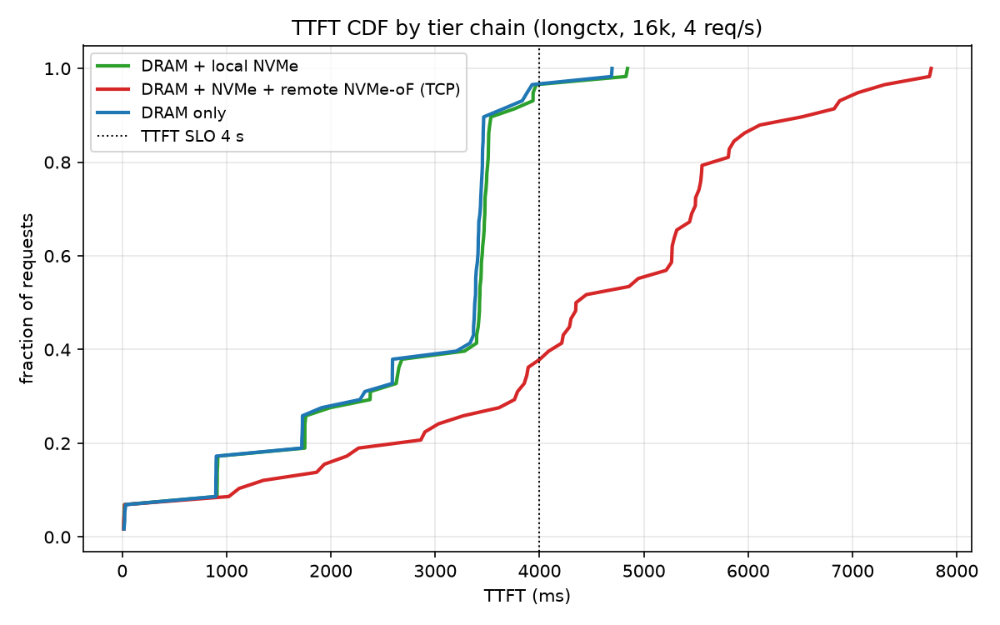
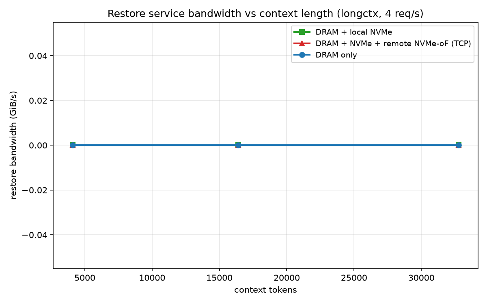
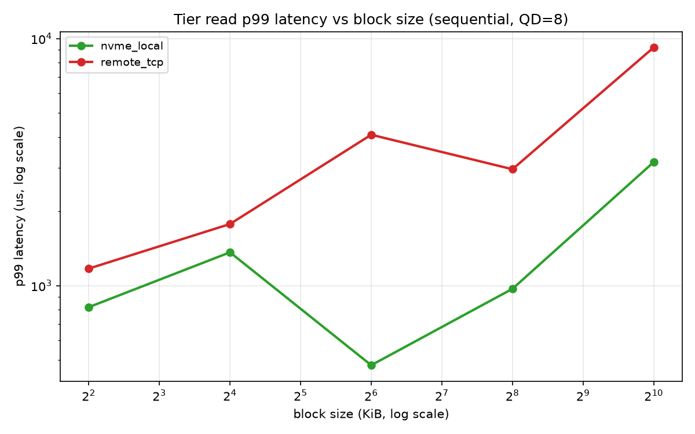

# KVOffloadBench

KVOffloadBench is a benchmark harness for the storage side of LLM serving. It
replays long-context multi-turn and agent-style traces at controlled Poisson
rates, records TTFT / TPOT / ITL / goodput / prefix-cache hit rate / KV
offload+restore bandwidth, verifies KV correctness after offload and reload,
and attributes the bottleneck to calibrated compute, queueing, local NVMe, or
the remote NVMe-oF path. The output is a storage requirements table
(bandwidth, IOPS, tail-latency budget) that an SSD, SoC, or fabric team can
design against.

**The question.** How far can an LLM engine's KV cache be pushed down the
storage hierarchy -- HBM -> host DRAM -> local NVMe -> remote NVMe-oF -- before
TTFT and goodput SLOs break, and what bandwidth, IOPS, and p99 latency must a
network-attached SSD deliver to hold the line?

## Architecture

```
 request traces (JSONL, seeded, shared prefixes)
            |
            v
  asyncio replay harness  (Poisson arrivals, max_concurrency, warmup + measured window)
            |
            v
  Engine  ----------------------------------------------------------------+
   real:      vLLM AsyncLLMEngine + LMCache / NIXL KV connector           |
   emulated:  calibrated gpt2 prefill/decode + REAL per-block tier I/O    |
            |                                                             |
            v                                                             |
  TieredKVStore (LRU demotion on overflow, admission-controlled promotion)|
   HBM (torch CUDA) -> DRAM (pinned/plain) -> NVMe file (O_DIRECT/F_NOCACHE)
                     -> remote TCP target (NVMe-oF-shaped frames)
                     -> /dev/nvmeXnY via NVMe-oF (RDMA/RoCE or TCP)       |
            |                                                             |
            v                                                             |
  per-request timestamps, per-tier hit/byte counters, TierStats          |
            |                                                             |
            v                                                             |
  results/raw/<run_id>/{requests.parquet, metrics.json, tier_stats.json,  |
                        config.yaml, manifest.json}                       |
            |                                                             |
            v                                                             |
  analysis: bottleneck attribution, storage requirements, six figures <--+
            |
            v
  Prometheus (:9100) -> Grafana dashboard
```

### Engine-mode selection rule

The rule is implemented in `kvoffloadbench/engines/factory.py` and every result
row records `mode` and the selection reason:

1. `engine.mode == "emulated"` -> calibrated emulator. All tier I/O is real.
2. `engine.mode == "real"` -> the requested connector (LMCache or NIXL). If it
   cannot be built, the run fails loudly; nothing is silently substituted.
3. `engine.mode == "auto"` (the default):
   - CUDA visible + `vllm` importable -> real vLLM; if `connector: nixl` is
     requested, NIXL is used only when the `nixl` package is importable.
   - otherwise -> calibrated emulator, with the reason logged at WARNING and
     recorded in `manifest.json` / `metrics.json`.

`real` means an actual vLLM + LMCache (or NIXL) engine. `emulated` means a real
tokenizer, real per-block KV traffic through the real tier stack, and
prefill/decode time calibrated from an actual local model run
(`results/calibration/engine_calibration.json`). No latency number is invented.

### File map

| Path | Responsibility |
|---|---|
| `kvoffloadbench/config.py` | dataclass config model, run YAML, sweep cross-product with include/exclude |
| `kvoffloadbench/env.py` | git sha, host/CPU/RAM/GPU, versions, pip-freeze hash, O_DIRECT probe, NVMe inventory |
| `kvoffloadbench/cli.py` | `env`, `gen-traces`, `bench-tiers`, `replay`, `sweep`, `validate`, `analyze` |
| `kvoffloadbench/tiers/` | `base.py` (stats/reservoir), `dram.py`, `hbm.py`, `nvme.py`, `nvmeof_block.py`, `remote_tcp.py`, `target/store.py`, `tiered_store.py` |
| `kvoffloadbench/target/` | asyncio TCP block target, wire protocol, launcher |
| `kvoffloadbench/engines/` | `vllm_lmcache.py`, `nixl.py`, `emulated.py`, `factory.py` |
| `kvoffloadbench/traces/generate.py` | deterministic longctx / agent-ReAct / shared-prefix-RAG traces |
| `kvoffloadbench/harness/` | `replay.py` (Poisson + warmup + drain), `sweep.py`, `prom.py` |
| `kvoffloadbench/metrics.py` | TTFT/TPOT/ITL/goodput and aggregate metrics |
| `kvoffloadbench/validate.py` | byte/tensor round-trip and greedy token equivalence |
| `kvoffloadbench/analysis/` | `bottleneck.py`, `requirements.py`, `plots.py` |
| `scripts/` | `setup_nvmeof_tcp.sh`, `teardown_nvmeof_tcp.sh` (nvmet/nvme-tcp, RDMA variant documented) |
| `configs/tiers_micro.yaml`, `configs/sweeps/main.yaml`, `configs/runs/` | microbench and experiment configs |
| `results/`, `docs/RUNBOOK.md`, `results/REPRODUCE.md` | measured artifacts and reproduction |

## How to run

### Install

```bash
python3.11 -m venv .venv && . .venv/bin/activate
pip install -e ".[dev]"          # CPU/laptop: real tiers + calibrated engine
pip install -e ".[gpu,dev]"      # H200 host: adds vLLM + LMCache + NIXL
kvoffloadbench env               # fingerprint JSON used in every manifest
```

### Generate traces

```bash
kvoffloadbench gen-traces --out traces/ --seed 2024
```

This writes `traces/longctx_multiturn.jsonl` (192 requests, 24 conversations x
8 turns, 4k -> 32k logical context), `traces/agent_react.jsonl` (320 ReAct
steps, 40 shared tool/system preambles), and `traces/shared_prefix_rag.jsonl`
(120 queries, 12 shared retrieved-document prefixes). Seeded and byte-for-byte
deterministic.

### Measure the storage tiers

```bash
kvoffloadbench bench-tiers --config configs/tiers_micro.yaml \
  --out results/tiers/microbench.csv
```

The run starts the TCP target in a subprocess, and measures DRAM, local NVMe,
and remote TCP; the `nvmeof_block` tier joins automatically when
`KVOB_NVMEOF_DEV` points at a connected namespace.

### One replay

```bash
kvoffloadbench replay --config configs/runs/dram_only.yaml
kvoffloadbench replay --config configs/runs/dram_nvme_remote.yaml --metrics-port 9100
```

### Full matrix and analysis

```bash
kvoffloadbench sweep --config configs/sweeps/main.yaml
kvoffloadbench analyze --results results/
kvoffloadbench validate --config configs/validate.yaml
```

`analyze` regenerates every table and figure deterministically (verified by
hashing the outputs of two consecutive runs).

### Docker / Prometheus / Grafana

```bash
docker compose build
docker compose up target prometheus grafana    # :4420, :9090, :3000
docker compose run --rm engine env
docker compose up engine                       # replay per configs/runs/compose.yaml
```

Grafana (admin / `kvoffloadbench`) loads `grafana/dashboard.json` through
`monitoring/grafana/provisioning`. The exporter exposes `kvob_ttft_seconds`,
`kvob_itl_seconds`, `kvob_e2e_seconds` histograms, `kvob_kv_bytes_total` per
tier/op, `kvob_inflight_requests`, and `kvob_goodput_ratio`.

### NVMe-oF TCP/RDMA

```bash
sudo scripts/setup_nvmeof_tcp.sh       # Linux, root; prints KVOB_NVMEOF_DEV
export KVOB_NVMEOF_DEV=/dev/nvme1n1
sudo scripts/teardown_nvmeof_tcp.sh
```

The RDMA/RoCE variant (BlueField-3, `nvme connect -t rdma`) and the full 4xH200
procedure are in [docs/RUNBOOK.md](docs/RUNBOOK.md).

## Results

All numbers below come from files this build produced. The measured artifacts
are committed under `results/`. This build ran on an **Apple M3 MacBook Air
(8 cores, 16 GiB RAM, macOS 27.2.1, no CUDA)**, so serving is `emulated`;
storage I/O is real. See [Limitations](#limitations--reproducibility).

### 1. Tier microbenchmark

Source: `results/tiers/microbench.csv` (160 measured points). Local NVMe is a
real preallocated file on the laptop SSD; macOS has no `O_DIRECT`, so the tier
used `F_NOCACHE` (`io_mode=fnocache`). The remote tier is a real Python asyncio
TCP target backed by a real file (`io_mode=tcp` on the client; the target
itself used `F_NOCACHE`). The `nvmeof_block` tier is absent because this host
has no `/dev/nvme*` and `nvme-cli` -- that is recorded, not fabricated.

**Read, sequential, queue depth 8** (latency p50/p99 per operation, GiB/s and
IOPS from wall-clock measurement):

| tier | block KiB | GiB/s | IOPS | p50 us | p99 us | I/O mode |
|---|---:|---:|---:|---:|---:|---|
| nvme_local | 4 | 0.08 | 20,580 | 64.8 | 817.8 | fnocache |
| nvme_local | 16 | 0.16 | 10,728 | 132.2 | 1,363.6 | fnocache |
| nvme_local | 64 | 1.23 | 20,073 | 188.4 | 476.0 | fnocache |
| nvme_local | 256 | 2.94 | 12,054 | 335.2 | 970.5 | fnocache |
| nvme_local | 1024 | 3.50 | 3,588 | 1,174.5 | 3,162.7 | fnocache |
| remote_tcp | 4 | 0.04 | 10,005 | 485.6 | 1,171.8 | tcp |
| remote_tcp | 16 | 0.13 | 8,295 | 520.8 | 1,775.1 | tcp |
| remote_tcp | 64 | 0.21 | 3,366 | 1,833.3 | 4,081.4 | tcp |
| remote_tcp | 256 | 1.09 | 4,465 | 986.8 | 2,958.7 | tcp |
| remote_tcp | 1024 | 1.65 | 1,690 | 2,863.8 | 9,210.5 | tcp |

DRAM at 256 KiB with queue depth 32 reached **12.19 GiB/s, 49,915 IOPS, p50
16.5 us, p99 51.1 us** (DRAM has no queue to fill; depth 1 and 32 were
measured). At queue depth 1 it reached 10.70 GiB/s.

**Queue-depth effect at 256 KiB reads:**

| tier | depth | GiB/s | IOPS | p50 us | p99 us |
|---|---:|---:|---:|---:|---:|
| dram | 1 | 10.70 | 43,817 | 17.4 | 58.0 |
| dram | 32 | 12.19 | 49,915 | 16.5 | 51.1 |
| nvme_local | 1 | 0.97 | 3,989 | 214.0 | 603.6 |
| nvme_local | 8 | 2.94 | 12,054 | 335.2 | 970.5 |
| nvme_local | 32 | 3.56 | 14,568 | 804.4 | 2,922.1 |
| remote_tcp | 1 | 0.50 | 2,055 | 445.8 | 1,291.8 |
| remote_tcp | 8 | 1.09 | 4,465 | 986.8 | 2,958.7 |
| remote_tcp | 32 | 1.34 | 5,494 | 3,744.0 | 7,372.1 |

Remote writes are the weak part of this implementation: the Python target
reaches only 0.47 GiB/s at 1 MiB and much less at 16-64 KiB (full rows in the
CSV). KV restore is a read path, so the read ceilings above are what the
requirements table uses; the write numbers are reported, not hidden.

### 2. Serving results: 16k context, medium cache, long-context trace

Source: `results/index.csv` and `results/raw/<run_id>/metrics.json`
(64 sweep points + 2 standalone replays = 66 rows). Times are milliseconds;
goodput is SLO-meeting requests/s; hit rate is KV-block prefix-cache hit rate;
restore is the window-average read bandwidth from colder tiers.

| tier chain | rate | TTFT p50 | TTFT p99 | TPOT p50 | TPOT p99 | goodput req/s | hit rate | restore GiB/s |
|---|---:|---:|---:|---:|---:|---:|---:|---:|
| dram_only | 1 | 3,411 | 3,534 | 10.4 | 11.2 | 1.00 | 0.095 | 0.000 |
| dram_nvme | 1 | 3,443 | 3,628 | 10.3 | 10.5 | 1.00 | 0.095 | 0.000 |
| dram_nvme_remote_tcp | 1 | 3,860 | 4,375 | 10.1 | 10.5 | 0.53 | 0.095 | 0.000 |
| dram_only | 2 | 3,398 | 3,488 | 10.3 | 11.7 | 1.53 | 0.113 | 0.000 |
| dram_nvme | 2 | 3,418 | 3,536 | 10.3 | 10.7 | 1.53 | 0.113 | 0.000 |
| dram_nvme_remote_tcp | 2 | 3,780 | 4,364 | 10.0 | 10.5 | 1.07 | 0.113 | 0.000 |
| dram_only | 4 | 3,383 | 4,692 | 10.6 | 12.6 | 3.73 | 0.087 | 0.000 |
| dram_nvme | 4 | 3,427 | 4,835 | 10.2 | 10.9 | 3.73 | 0.087 | 0.000 |
| dram_nvme_remote_tcp | 4 | 4,399 | 7,744 | 9.8 | 10.6 | 1.40 | 0.087 | 0.000 |
| dram_only | 8 | 6,506 | 12,130 | 10.7 | 14.2 | 1.67 | 0.035 | 0.000 |
| dram_nvme | 8 | 6,127 | 11,845 | 10.2 | 10.9 | 2.13 | 0.104 | 0.008 |
| dram_nvme_remote_tcp | 8 | 8,976 | 16,476 | 9.2 | 10.7 | 1.07 | 0.104 | 0.008 |

TPOT stays at 9-14 ms throughout: the SLO misses are all TTFT misses, driven by
queued prefill and, for the remote chain, restore wait.

**Context cap 32768, rate 8, all three traces:**

| trace | tier chain | TTFT p50 | TTFT p99 | goodput req/s | goodput frac | hit rate |
|---|---|---:|---:|---:|---:|---:|
| agent_react | dram_only | 865 | 961 | 7.73 | 1.00 | 0.174 |
| agent_react | dram_nvme | 875 | 975 | 7.73 | 1.00 | 0.174 |
| agent_react | dram_nvme_remote_tcp | 3,040 | 7,061 | 4.47 | 0.58 | 0.170 |
| longctx_multiturn | dram_only | 10,768 | 21,357 | 0.93 | 0.12 | 0.025 |
| longctx_multiturn | dram_nvme | 10,090 | 21,121 | 1.33 | 0.17 | 0.095 |
| longctx_multiturn | dram_nvme_remote_tcp | 14,978 | 30,662 | 1.00 | 0.13 | 0.095 |
| shared_prefix_rag | dram_only | 9,267 | 17,304 | 1.07 | 0.14 | 0.047 |
| shared_prefix_rag | dram_nvme | 9,367 | 17,192 | 1.67 | 0.22 | 0.120 |
| shared_prefix_rag | dram_nvme_remote_tcp | 34,658 | 62,484 | 0.60 | 0.08 | 0.117 |

Agent traces keep their 4k-token preamble: TTFT stays under 1 s on local tiers,
but the remote chain adds 2.2 s at p50 and 6.1 s at p99. Long-context and RAG
requests are far over the 4 s SLO at 8 req/s even with DRAM only: the binding
resource at that load is the calibrated prefill/queueing budget, not the SSD.

**Headline deltas (rate 8):**

- At 16k context: DRAM-only -> local NVMe -> remote gives TTFT p50
  **6.51 s -> 6.13 s -> 8.98 s** and goodput **1.67 -> 2.13 -> 1.07 req/s**.
  The NVMe chain beats DRAM-only because DRAM-only is the last tier and drops
  blocks it evicts (hit rate 3.5% vs 10.4%); local NVMe retains them.
- At 32k context, long-context trace: **10.77 s -> 10.09 s -> 14.98 s** and
  **0.93 -> 1.33 -> 1.00 req/s**. Remote vs local NVMe is **+48% TTFT** and
  **-25% goodput** at the same offered load; remote p99 reaches 30.7 s.
- At 32k, 8 req/s, RAG: local NVMe 9.37 s vs remote 34.66 s TTFT p50
  (**+270%**), goodput 1.67 -> 0.60 req/s. The TCP target is the only tier with
  enough restore work to queue visibly.
- TPOT is essentially flat across tiers (9-14 ms), so the SLO cost of offload
  shows up in TTFT and goodput, not decode smoothness.

**Cache-size axis (16k, 4 req/s, longctx):**

| tier chain | DRAM cache | TTFT p50 | goodput req/s | hit rate | restore GiB/s |
|---|---|---:|---:|---:|---:|
| dram_nvme | small (64 MiB) | 3,490 | 3.73 | 0.087 | 0.019 |
| dram_nvme | medium (512 MiB) | 3,427 | 3.73 | 0.087 | 0.000 |
| dram_nvme | large (2048 MiB) | 3,418 | 3.60 | 0.087 | 0.000 |
| dram_nvme_remote_tcp | small (64 MiB) | 7,452 | 0.60 | 0.087 | 0.019 |
| dram_nvme_remote_tcp | medium (512 MiB) | 4,399 | 1.40 | 0.087 | 0.000 |
| dram_nvme_remote_tcp | large (2048 MiB) | 11,241 | 0.47 | 0.087 | 0.000 |

The hit-rate curve did **not** collapse across 64 MiB -> 2 GiB: it stayed at
8.7% for every capacity. The reason is structural and visible in the traces:
the genuinely shared prefix is only about 1.4k tokens (87 KV blocks), which fits
even a 64 MiB cache. What changes is where the non-shared blocks live: the small
cache spills to NVMe/remote (restore bandwidth appears, 0.019 GiB/s) and the
remote p50 TTFT rises from 4.4 s to 7.5 s. The `large` remote point (11.2 s,
0.47 req/s) is queue-dominated (4.2 s mean queue wait per request, 58 requests
in the window); the bottleneck table labels it `queueing_concurrency`, and it is
reported as measured rather than smoothed away. The honest conclusion is that
this trace's reuse is limited by prefix divergence at each turn, not by cache
capacity in the tested range.

### 3. KV correctness

Source: `results/validation/kv_correctness.json`.

| check | result |
|---|---|
| tiers exercised round-trip | DRAM, local NVMe, remote TCP target |
| blocks compared | 40 (3 standalone tiers x 8 + forced-demotion last-tier and promoted reads) |
| byte mismatches | **0** |
| SHA-256 mismatches | **0** |
| forced demotions to remote | 8 of 8 blocks present in the last tier |
| token exact-match rate | **1.0** (3 prompts x 8 greedy tokens, 3 tier chains vs offload-disabled reference) |
| mode | `emulated` (real tier I/O; no CUDA on this host) |

The validator also contains a self-check: a deliberately corrupting tier makes
`_check_blocks` report nonzero mismatches (`tests/test_validate.py`), so a green
result is not vacuous.

### 4. Bottleneck attribution

Source: `results/tables/bottleneck_attribution.{csv,md}`.

Of 66 runs: **34 `slo_headroom`, 20 `compute_calibrated`, 12
`queueing_concurrency`, 0 `storage_*`**. Storage was never the binding resource
at the offered loads on this host. The maximum achieved/measured ceiling was
**0.422 of remote read bandwidth** and **0.674 of remote read IOPS**; the highest
achieved restore rate was **0.733 GiB/s** against a measured 1.647 GiB/s remote
ceiling. Only 9 of 66 runs performed any restore at all (2.73 GiB restored in
total versus 145.71 GiB offloaded), because the trace's shared prefixes are
small relative to context. When the SLO was missed, the label came from measured
queue wait or the calibrated compute share, not from a guess about the SSD.

This is the intended output of the tool: on a host with faster storage and a
slower/real GPU, the same table will flip to `storage_remote_tcp` once the
achieved/ceiling ratio approaches 1. The per-run CSV carries `compute_s`,
`restore_s`, `queue_s`, their shares and utilizations, achieved and ceiling
bandwidth/IOPS, and the pressure ratios so that flip is auditable.

### 5. Measured storage requirements (Llama-3.3-70B, 4x H200, TP=4)

Source: `results/tables/storage_requirements.{csv,md}`. Formulas (as stated in
the generated markdown):

```
restore_bytes/request = context_tokens x bytes_per_token
storage_blocks        = ceil(restore_bytes / 128 KiB)
required bandwidth    = restore_bytes / TTFT_budget
sustained bandwidth   = restore_bytes x request_rate
required IOPS         = storage_blocks / TTFT_budget
p99 block budget      = TTFT_budget / storage_blocks
```

Assumptions: 80 layers x 2 x 8 KV heads x 128 head_dim x 2 B =
**327,680 B/token total**, TP=4 splits it to 81,920 B/token/rank; a full prefix
miss; the full 4 s TTFT budget is allocated to storage (conservative -- subtract
measured H200 prefill before deployment); 128 KiB storage blocks (a 70B
16-token KV block is 5 MiB = 40 storage blocks); prefix hits reduce the bytes
actually moved. `sustained` is the worst-case aggregate with no prefix reuse.

| ctx | rate | KV GiB/req | per-rank GiB | blocks @128K | req GiB/s | per-rank GiB/s | sustained GiB/s | req IOPS | p99 us QD1 | p99 us QD8 |
|---:|---:|---:|---:|---:|---:|---:|---:|---:|---:|---:|
| 4096 | 1 | 1.25 | 0.31 | 10,240 | 0.31 | 0.078 | 1 | 2,560 | 390.6 | 3,125 |
| 4096 | 2 | 1.25 | 0.31 | 10,240 | 0.31 | 0.078 | 2 | 2,560 | 390.6 | 3,125 |
| 4096 | 4 | 1.25 | 0.31 | 10,240 | 0.31 | 0.078 | 5 | 2,560 | 390.6 | 3,125 |
| 4096 | 8 | 1.25 | 0.31 | 10,240 | 0.31 | 0.078 | 10 | 2,560 | 390.6 | 3,125 |
| 16384 | 1 | 5.00 | 1.25 | 40,960 | 1.25 | 0.312 | 5 | 10,240 | 97.7 | 781 |
| 16384 | 2 | 5.00 | 1.25 | 40,960 | 1.25 | 0.312 | 10 | 10,240 | 97.7 | 781 |
| 16384 | 4 | 5.00 | 1.25 | 40,960 | 1.25 | 0.312 | 20 | 10,240 | 97.7 | 781 |
| 16384 | 8 | 5.00 | 1.25 | 40,960 | 1.25 | 0.312 | 40 | 10,240 | 97.7 | 781 |
| 32768 | 1 | 10.00 | 2.50 | 81,920 | 2.50 | 0.625 | 10 | 20,480 | 48.8 | 391 |
| 32768 | 2 | 10.00 | 2.50 | 81,920 | 2.50 | 0.625 | 20 | 20,480 | 48.8 | 391 |
| 32768 | 4 | 10.00 | 2.50 | 81,920 | 2.50 | 0.625 | 40 | 20,480 | 48.8 | 391 |
| 32768 | 8 | 10.00 | 2.50 | 81,920 | 2.50 | 0.625 | 80 | 20,480 | 48.8 | 391 |

Read this as a fabric/SSD design target: a 32k-token 70B full restore needs
**2.5 GiB/s aggregate (0.625 GiB/s per rank)**, **20,480 IOPS at 128 KiB**, and
a **48.8 us p99 per 128 KiB read** to fit one request's 4 s TTFT budget
(390.6 us if the 8-deep pipeline participates). At 8 req/s with no prefix reuse
the same workload would require **80 GiB/s** of sustained restore bandwidth,
which is why prefix caching and KV reuse are prerequisites, not optimizations.

For the local declared shape (6,144 B/token, 96 MiB per 16k request), the
requirements table shows a required **0.189 GiB/s** after subtracting the
measured 3.50 s prefill, and the best measured restore was **0.663 GiB/s** at
16k/8 -- it met the per-request bandwidth requirement, yet the run still missed
the SLO because compute and queueing dominated. At 32k the calibrated prefill
alone is **7.01 s**, so the I/O budget is zero and the table says so instead of
printing an invented requirement.

### 6. Figures

Generated by `kvoffloadbench analyze` into `results/figures/`.













### 7. Build health and cost

- Sweep: **64 real points + 2 standalone replays = 66 result rows**, all
  completed, no failures (`results/index.csv`).
- Sweep wall-clock: **27.9 min**; sum of per-point wall clocks **28.1 min**
  (15 s measured window + 1 s warmup + drain per point).
- Tests: **35 passed**; coverage **53%** (`python -m pytest
  --cov=kvoffloadbench`). Ruff and strict mypy (`kvoffloadbench/`, untyped
  third-party imports allowed) pass with zero errors.
- Largest restore observed: **0.733 GiB/s**; total measured KV restored
  **2.73 GiB**; total offloaded **145.71 GiB**.
- `analyze` determinism: repeated runs produced identical hashes for all
  tables and figures.

## Limitations and reproducibility

- **Hardware.** This build ran on an Apple M3 MacBook Air, 8 cores, 16 GiB RAM,
  macOS 27.2.1, Python 3.11.14, torch 2.15.0, transformers 5.23.0. There is no
  CUDA GPU, no vLLM, no LMCache, no NIXL, no `nvme-cli`, and no `/dev/nvme*`.
  `env` reported `cuda_available=false`, `mps_available=true`.
- **Measured vs calibrated.** DRAM, local file NVMe (with `F_NOCACHE`), and the
  remote TCP target were measured with real I/O and real sockets. Serving
  latency is `emulated`: gpt2 (124.4 M parameters) was run on MPS to calibrate
  **0.2139 ms prefill/token** and **8.4288 ms decode/token**, and the emulator
  sleeps those amounts while driving real per-block tier traffic. Every result
  row records `mode=emulated`; no row claims to be a real 70B serving result.
  The local KV shape is 12 layers / 2 KV heads / head_dim 64 / fp16 =
  6,144 B/token, chosen so real 32k-context I/O is feasible on a laptop. The
  requirements table scales to the 70B shape explicitly.
- **NVMe-oF.** No NVMe-oF namespace was available, so `nvmeof_block` could not
  run here. Its code path, the `nvmet`/`nvme-tcp` setup script, the RDMA/RoCE
  variant, and the exact 4xH200 runbook are provided in
  [docs/RUNBOOK.md](docs/RUNBOOK.md). On a host with `KVOB_NVMEOF_DEV` set, the
  tier performs aligned `O_DIRECT` I/O against the namespace and joins the
  microbench and validation automatically.
- **`O_DIRECT`.** macOS has no `O_DIRECT`; the local NVMe tier used
  `F_NOCACHE` (cache bypass) and reports `io_mode=fnocache`. The Linux CI host
  and the H200 host exercise the real `O_DIRECT` path.
- **Remote target.** The target is a Python asyncio server; its throughput is a
  property of this implementation, measured honestly (1.65 GiB/s best read),
  not a property of NVMe-oF hardware. Its write path is the weak spot (see the
  CSV); restore is a read path.
- **Prefix reuse.** Measured hit rates are 8-30%, below the theoretical upper
  bound printed by `gen-traces` (78-90%), because each turn/step adds unique
  history between the shared system prefix and the padded tail. The benchmark
  reports the measured value, not the bound.
- **Run-to-run variance.** The large-cache remote point is queue-dominated and
  is reported as such. The machine was otherwise idle during the sweep; no
  results were discarded or re-rolled.

The literal command sequence, including timings and versions, is in
[results/REPRODUCE.md](results/REPRODUCE.md). To reproduce on this laptop:
`pip install -e ".[dev]"`, `kvoffloadbench gen-traces`, `kvoffloadbench
bench-tiers`, `kvoffloadbench sweep`, `kvoffloadbench analyze`. To reproduce
the real-engine path, follow the runbook on a 4xH200 + BlueField-3 host.

## License

MIT. See [LICENSE](LICENSE).
